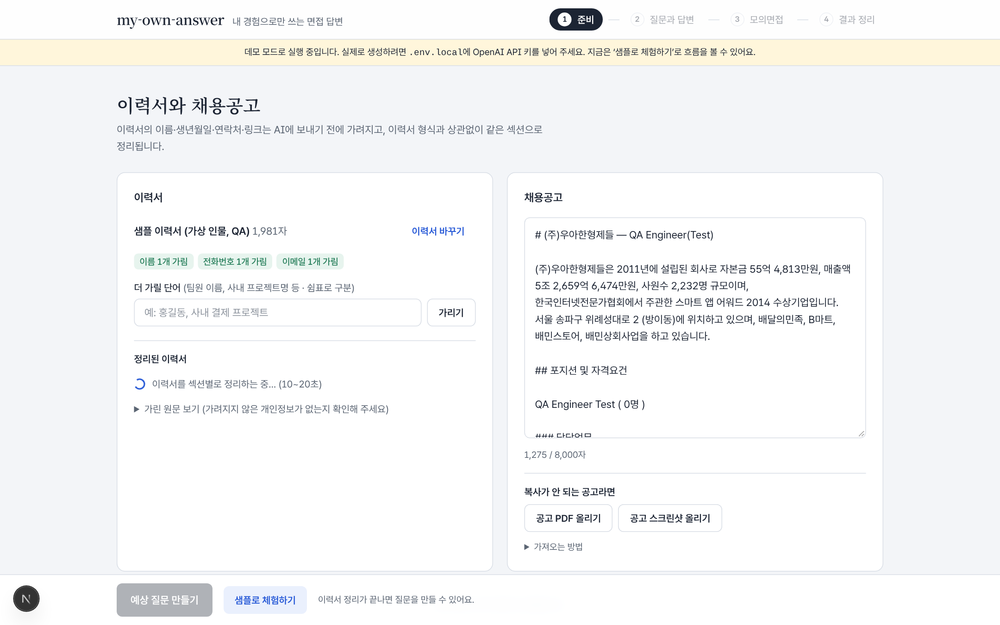
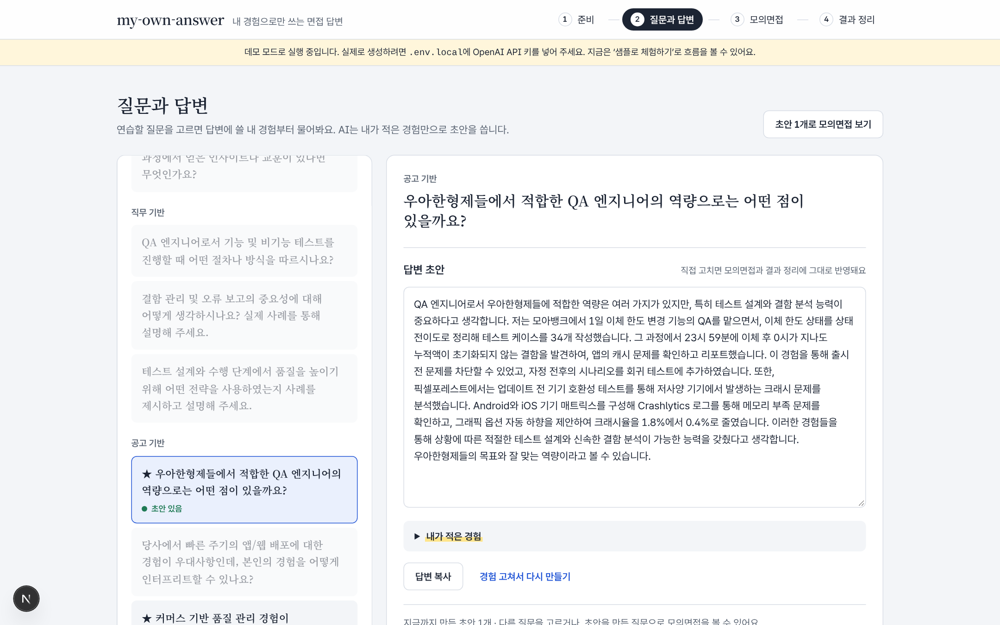
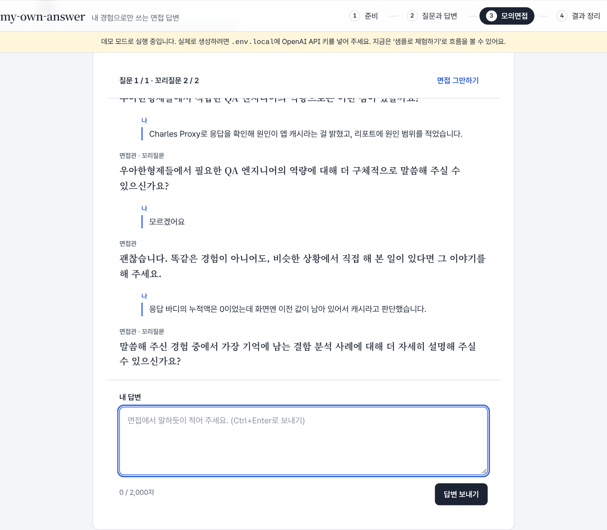

# my-own-answer

**AI가 지어낸 답이 아니라, 내 경험으로만 쓰는 면접 답변.**
이력서와 채용공고로 예상 질문을 만들고, 답변을 쓰기 전에 **내 경험을 먼저 물어본 뒤 그 경험으로만** 답변 초안을 씁니다. 텍스트 모의면접과 결과 정리(HTML · Notion)까지 한 번에 이어집니다.

> AI 네이티브 커리어 캠프 2기 · 1차 개인 프로젝트

| | |
| --- | --- |
| 배포 | **https://my-own-answer.vercel.app** — API 비용 때문에 데모 모드로 운영합니다. **샘플로 체험하기**로 처음부터 결과 정리까지 볼 수 있어요 |
| 시연 영상 | [my-own-answer-demo.mp4 (1분 25초)](https://github.com/user-attachments/assets/09582172-7683-4939-b8bf-cb47d65375d3) |
| 발표 핵심 | 내 경험 근거 비율 **42.9% → 90.0%**, 모의면접 꼬리질문 지어냄 **0 / 15** |


https://github.com/user-attachments/assets/09582172-7683-4939-b8bf-cb47d65375d3

---

## 왜 만들었나

AI에게 면접 답변을 맡기면 **내가 하지 않은 경험이 그럴듯하게 섞입니다.** 면접장에서 꼬리질문 한 번에 무너지는 답이 됩니다.
먼저 숫자로 확인했습니다. 경험을 묻지 않고 이력서·공고만 준 기준선으로 답변 5개(77문장)를 만들어 문장마다 채점했더니:

- 지어낸 경험 문장 **12개** (하지 않은 공부·QA 경험 등)
- 내 경험 근거 비율 **42.9%**, 일반론 **73%**

그래서 **경험을 먼저 묻고, 적은 경험과 이력서에 있는 사실만으로 쓰는** 흐름을 만들었습니다.

## 결과 (숫자)

| 지표 | 처음 | 지금 | 근거 |
| --- | --- | --- | --- |
| 답변 초안의 내 경험 근거 비율 | 42.9% | **90.0%** | [compare-answer-v1-v2.md](data/results/compare-answer-v1-v2.md) |
| 답변 초안의 지어낸 문장 (5건) | 12 | **2** | 같은 문서 |
| 모의면접: 내 답을 파고든 꼬리질문 | 2 / 5 | **5 / 5** | [compare-interviewer-v1-v2-v3.md](data/results/compare-interviewer-v1-v2-v3.md) |
| 모의면접: 사용자에게 보인 지어낸 꼬리질문 | 1 / 25 (v2) | **0 / 15** (v4) | 같은 문서 |
| 이력서 정리 수치 보존 (형식 3종) | - | **89 / 89** | `data/results/2026-11-01-structure-v1` |
| 공고 스크린샷 판독 글자 정확도 | 76.2% | 원인 3가지 수정, 재측정 예정 | [bugs.md BUG-007](docs/qa/bugs.md) |

채점은 문장(꼬리질문)마다 Claude가 근거 위치와 함께 1차 라벨을 달고, 본인이 검토해 확정했습니다. 평가 세트는 가상 이력서 5개 × 공개 공고로 작아서, 수치는 방향을 보여 주는 용도입니다.

## 화면

| 이력서와 채용공고 | 질문과 답변 | 모의면접 |
| --- | --- | --- |
|  |  |  |

## 주요 기능

1. **이력서·공고 넣기** — PDF/TXT/MD(10MB)는 브라우저에서 글자만 뽑아 보내고 원본은 서버로 보내지 않습니다. 이름·생년월일·연락처·링크는 AI에 보내기 전에 가리고, 가린 결과를 화면에 보여 줍니다. 피그마·노션·원티드 등 형식이 달라도 같은 섹션(경력·프로젝트·트러블슈팅·기술 스택·교육·자격증·수상)으로 정리하고, 정리본의 숫자가 원문에 있는지 검사합니다.
2. **복사가 막힌 공고** — PDF 저장 또는 스크린샷으로 가져옵니다.
3. **예상 질문** — 이력서 기반 · 직무 기반 · 공고 기반.
4. **내 경험 먼저 → 답변 초안** — 적은 경험과 이력서의 사실만으로 씁니다. 경험이 없으면 지어내지 않고 인정한 뒤 가까운 실제 경험으로 연결합니다. 초안은 화면에서 직접 고칠 수 있습니다.
5. **텍스트 모의면접** — 내 답을 파고드는 꼬리질문 최대 2개, 질문별 피드백(잘한 점 · 보완할 점 · 다음엔). "모르겠어요"·너무 짧은 답은 AI 없이 규칙으로 처리합니다.
6. **결과 정리** — HTML 파일 저장, Notion에 붙여넣을 Markdown 복사. 이력서 내용은 넣지 않습니다.

### 지어내지 않게 만든 설계

- 답변 프롬프트는 v1 채점에서 찾은 문제(맞는 경험이 없을 때 지어냄 · 일반론 · 가림 표시 노출)를 그대로 규칙으로 옮겼습니다.
- 모의면접 꼬리질문은 프롬프트 규칙만으로는 지어냄이 남아서(v2), **지어낼 자리를 없앴습니다**: 모호한 답에는 AI가 문장 대신 이력서 항목 이름만 고르고, 코드가 그 이름이 이력서에 정말 있는지 대조한 뒤 문장을 만듭니다. 평가에서 AI가 질문 문구를 이력서 항목처럼 넣은 5번은 모두 코드에서 막혔습니다.

## 실행 방법

필요한 것: Node.js 20 이상, (실제 생성 시) OpenAI API 키

```bash
git clone https://github.com/kzlsk/my-own-answer.git
cd my-own-answer
npm install                    # 글꼴(Pretendard, Noto Serif KR)도 함께 설치됩니다
cp .env.example .env.local     # Windows: copy .env.example .env.local
npm run dev                    # http://localhost:3000
```

- `.env.local`의 `OPENAI_API_KEY`를 비워 두면 **데모 모드**로 실행되어 미리 만든 샘플 결과만 보여 줍니다. 키를 넣으면 실제로 생성합니다(기본 모델 gpt-4o-mini, 공고 스크린샷 판독만 gpt-4o).
- 처음이라면 **샘플로 체험하기** → ★ 질문 → **샘플 경험 채우기** → 모의면접 **샘플 답 채우기** 순서로 결과 정리까지 직접 입력 없이 볼 수 있습니다.
- 데모 샘플을 실제 생성 결과로 다시 만들려면 키를 넣고 `npm run demo:build`.

## 테스트 · QA

기능마다 TC를 먼저 설계하고(정상 · 경계 · 예외 · 보안), 화면에서 확인할 수 있는 것은 Playwright로 자동화했습니다. E2E는 데모 모드와 응답 흉내(route mock)로 돌아 API 비용이 들지 않습니다.

| | |
| --- | --- |
| 테스트 케이스 | 65개, 자동화 58개 |
| 매 회귀 실행 | E2E 47개 × 데스크톱·모바일 = 94 + 단위 41 |
| 찾아서 고친 버그 | 8개 (Critical 1 · Major 6 · Minor 1) |

```bash
npx playwright install chromium   # 처음 한 번
npm run test:unit
npm run test:e2e
npm run test:report
```

| 문서 | 내용 |
| --- | --- |
| [테스트 케이스](docs/qa/test-cases.md) | 영역별 TC와 결과 |
| [버그 리포트](docs/qa/bugs.md) | 재현 절차 · 근거(Console·Network) · 원인 · 수정 확인 |
| [테스트 결과](docs/qa/test-report.md) | 실행 기록 |

## AI 활용 기록

| 문서 | 내용 |
| --- | --- |
| [프롬프트.md](프롬프트.md) | 서비스 프롬프트 버전별 변경 이유와 수치, 만들면서 Claude에게 준 주요 요청 |
| [docs/ai-log.md](docs/ai-log.md) | AI가 틀린 사례 15건과 고친 방법, 설계 판단 43건 |
| [CLAUDE.md](CLAUDE.md) | 개발 규칙(범위 · API 키 · 안정성 · QA) |
| `.claude/skills/` | 프로젝트 스킬 5개: make-test-data · run-eval · log-prompt · write-tc · e2e-test |

평가 스크립트 (API 비용 발생, `--dry-run`이면 흐름만 확인):

```bash
npm run eval -- --target answer --version v2 --limit 5   # 답변 초안
npm run eval:interview -- --version v4                   # 모의면접 꼬리질문
npm run eval:structure                                   # 이력서 정리 수치 보존
npm run eval:ocr                                         # 공고 스크린샷 판독 (npm run dev를 키와 함께 켠 상태)
npm run eval:score -- data/results/<결과 폴더>           # 채점한 scoring.csv 집계
```

## 폴더 구조

| 경로 | 내용 |
| --- | --- |
| `src/app` | 화면과 API 라우트 |
| `src/components` | 단계별 화면 (준비 · 질문과 답변 · 모의면접 · 결과 정리) |
| `src/lib` | 마스킹, 이력서 정리, 면접 규칙, 내보내기, OpenAI 호출 |
| `prompts/` | 프롬프트 원문 (버전별) |
| `data/` | 가상 이력서, 공개 공고, 평가 결과와 비교 문서 |
| `docs/` | QA 문서, AI 활용 기록, 화면·시연 영상 |
| `tests/` | Playwright E2E, 단위 테스트 |

## 기술 스택

Next.js 15 (App Router) · TypeScript · Tailwind CSS v4 · OpenAI API · unpdf · Playwright · Vercel

## 한계와 다음 단계

- 평가 세트가 작아(5개 조합) 수치를 일반화하기 어렵습니다.
- 예상 질문 프롬프트는 v1 그대로이고, 공고 판독 v2는 재측정 전입니다.
- 다음: 예상 질문 품질 지표(공고 키워드 반영률 · 중복률)로 v2, 음성 모의면접, 평가 세트 확대.
